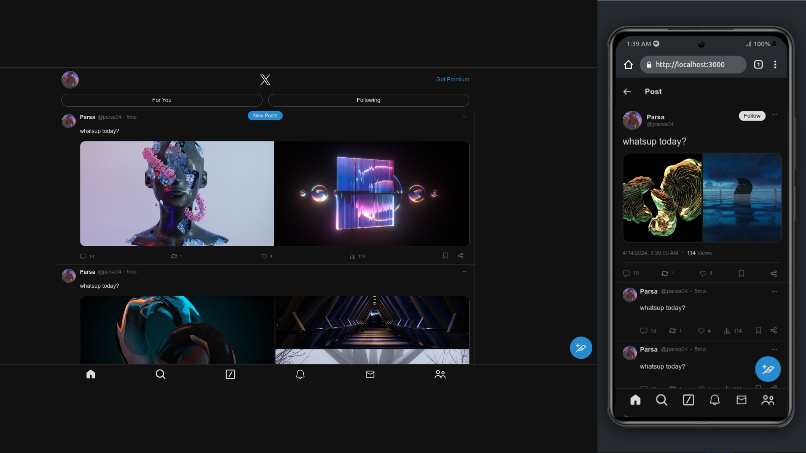

# Twitter X Clone

## Preview

## Overview
This application is a frontend clone of Twitter (X), developed using core web technologies including HTML, Sass (CSS), and JavaScript, without any frameworks or libraries. The project showcases my skills in fundamental web development concepts. Key tools used in the development process include Webpack, Babel, Gulp, and Workbox.

## Functionalities
The app simulates various behaviors of Twitter (X), allowing users to:

- View posts on the homepage
- Navigate to a user panel to see their posts
- Click on a post to view its content and comments
- Write and add posts, which are saved in IndexedDB and rendered dynamically on the user panel page
- Delete their posts from both IndexedDB and the user panel (DOM)
- Future features will include the ability to attach media to posts

## Loading and Rendering Posts
The `loadPosts(area)` function in the `loadPosts.js` file is responsible for loading and rendering posts. Other scripts like `home.js` and `user-panel.js` utilize this function by specifying the area (feed, user-panel, comments, etc.). The function performs the following tasks:

- Loads author information (avatar, username, ID)
- Loads text content
- Loads attached media (images/videos)
- Loads analytics information (reposts, likes, etc.)

## Posting Mechanism
Each post is represented as a `<user-tweet>` custom tag, implemented as a Web Component within the `components/user-tweet/` directory. The information for each post is generated dynamically.

## Skills Used
1. **Single Page Application (SPA)**: Implemented using vanilla JavaScript (`spa.js`, `router.js`)
2. **Web Components**: For creating standalone components (e.g., `<user-tweet>`)
3. **Progressive Web Application (PWA)**: Made installable on devices using a service worker (`sw.js`) with Workbox plugins
4. **Cache Storage API**: To enable offline functionality by caching assets
5. **IndexedDB**: Utilized for saving user and tweet data offline via Promise API
6. **Sass (.scss)**: For styling pages
7. **Gulp**: Used for compiling Sass files separately from general styles
8. **ES Modules**: For modular JavaScript code organization
9. **Webpack**: For bundling JavaScript files

## Technologies Used

**Languages:**
- HTML5
- CSS
- Sass
- JavaScript

**Tools:**
- **Webpack**: Bundles all JavaScript files/modules
- **Gulp**: Compiles Sass files that require separate handling from general styles

**APIs:**
- **Workbox Modules**: Provides PWA functionalities like caching and serving assets
- **IndexedDB API**: Stores offline data for the PWA
- **localStorage**: Used for setting/getting data related to individual posts when users navigate to specific post pages (as there is currently no backend API).

## Usage
To use this application, visit the [deployment page](https://github.com/parsa-farahani/Twitter-X-clone-deployment/) or run 'npm install' then 'npm start'

## Contact Information
For inquiries or feedback, please reach out via email at [aiparsa83@gmail.com](mailto:aiparsa83@gmail.com) or connect with me on [LinkedIn](https://www.linkedin.com/in/parsa-farahani-935195293).
